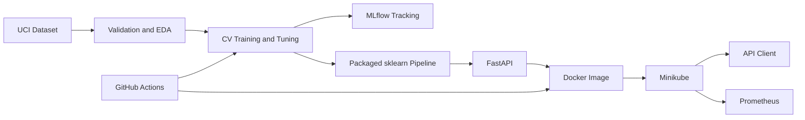

# Heart Disease MLOps

End-to-end, reproducible heart-disease classification using the public UCI
Cleveland dataset, MLflow, FastAPI, Docker, GitHub Actions, Minikube, and
Prometheus.

> This educational model is not a medical device and must not be used for
> clinical decisions.

## Results

The deterministic training workflow compares Logistic Regression and Random
Forest with stratified five-fold cross-validation. Logistic Regression is the
selected model.

| Model | CV ROC-AUC | Test accuracy | Test precision | Test recall | Test ROC-AUC |
|---|---:|---:|---:|---:|---:|
| Logistic Regression | 0.9031 | 0.8852 | 0.8387 | 0.9286 | 0.9665 |
| Random Forest | 0.9007 | 0.8689 | 0.8125 | 0.9286 | 0.9405 |

The held-out split is used for assignment demonstration. A real medical system
would require larger external datasets and independent clinical validation.

## Architecture



## Repository layout

```text
.
├── .github/workflows/ci.yml
├── data/
├── docs/
├── examples/
├── k8s/
├── models/
├── monitoring/
├── reports/
├── scripts/
├── src/
├── tests/
├── Dockerfile
├── Makefile
└── requirements.txt
```

## Prerequisites

- Python 3.12
- Git
- Docker CLI with Colima
- kubectl
- Minikube

No dataset, MLflow, container-registry, or cloud credentials are required.

## Setup

```bash
python3.12 -m venv .venv
source .venv/bin/activate
python -m pip install --upgrade pip
python -m pip install -r requirements.txt
```

Or:

```bash
make setup
```

## Data and EDA

Re-download the UCI data and generate EDA:

```bash
python scripts/download_data.py
python scripts/run_eda.py
```

The data validator enforces the expected 14-column schema, required values,
and documented categorical domains. The dataset contains 303 rows, no
duplicates, four missing `ca` values, and two missing `thal` values. EDA
artifacts are written to `reports/eda/`.

## Train and track experiments

```bash
python scripts/train.py
mlflow ui --backend-store-uri ./mlruns
```

Open <http://127.0.0.1:5000> to compare runs. Training logs parameters,
cross-validation ROC-AUC, test metrics, confusion matrices, ROC curves, model
signatures, and model artifacts.

The selected complete preprocessing/classifier pipeline is written to:

- `models/heart_disease_pipeline.joblib`
- `models/metadata.json`

## Test and lint

```bash
flake8 src scripts tests
pytest -q
```

Or run the complete local validation:

```bash
make validate
```

## Run the API locally

```bash
uvicorn src.api:app --host 0.0.0.0 --port 8000
```

In another terminal:

```bash
curl http://127.0.0.1:8000/health
curl -X POST http://127.0.0.1:8000/predict \
  -H 'Content-Type: application/json' \
  --data @examples/patient.json
curl http://127.0.0.1:8000/metrics
```

Interactive OpenAPI documentation is available at
<http://127.0.0.1:8000/docs>.

## Docker

Build and run:

```bash
export DOCKER_API_VERSION=1.43
docker build -t heart-disease-mlops:latest .
docker run --rm -p 8000:8000 heart-disease-mlops:latest
```

Test with the same `/health` and `/predict` commands above.

`DOCKER_API_VERSION` keeps the current Homebrew Docker CLI compatible with the
Docker engine in the existing Colima profile. It can be omitted after upgrading
that profile to an engine supporting the CLI's default API version.

## Minikube deployment

Start an assignment-approved, free local Kubernetes cluster:

```bash
export DOCKER_API_VERSION=1.43
minikube start --driver=docker
minikube image load heart-disease-mlops:latest
kubectl apply -f k8s/api.yaml
kubectl rollout status deployment/heart-disease-api --timeout=180s
```

Get the API URL:

```bash
minikube service heart-disease-api --url
```

Use the returned URL:

```bash
API_URL="$(minikube service heart-disease-api --url)"
curl "$API_URL/health"
curl -X POST "$API_URL/predict" \
  -H 'Content-Type: application/json' \
  --data @examples/patient.json
```

## Monitoring and logging

Deploy Prometheus:

```bash
kubectl apply -f k8s/prometheus.yaml
kubectl rollout status deployment/prometheus --timeout=180s
minikube service prometheus --url
```

Open the returned URL, visit **Status → Target health**, and verify that
`heart-disease-api` is UP. Generate prediction traffic, then query metrics such
as `http_requests_total`.

View application logs:

```bash
kubectl logs deployment/heart-disease-api
```

## CI/CD

`.github/workflows/ci.yml` runs on pushes and pull requests to `main`:

1. install pinned dependencies;
2. lint;
3. test;
4. train and package the model;
5. build the serving image;
6. upload model and report artifacts.

Any command failure fails the workflow and leaves explicit step logs.

## Cleanup

Stop the local cluster without deleting it:

```bash
minikube stop
```

Delete it completely:

```bash
minikube delete
```

## Submission material

- Report draft: `docs/report.md`
- Screenshot checklist: `screenshots/README.md`
- Video checklist: `docs/video-checklist.md`

The report must be exported to the instructor-required DOCX/PDF format after
inserting screenshots from the final GitHub Actions and Minikube runs.

## Dataset source

[UCI Heart Disease dataset](https://archive.ics.uci.edu/dataset/45/heart+disease)
