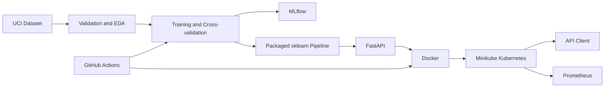

# Heart Disease Prediction: End-to-End MLOps Report

## 1. Executive summary

This project implements a reproducible machine-learning system for predicting
the presence of heart disease from the UCI Cleveland dataset. It covers data
acquisition, validation, exploratory analysis, model development, experiment
tracking, packaging, automated testing, CI, containerization, Kubernetes
deployment, request logging, and Prometheus monitoring.

The selected model is Logistic Regression. On the deterministic 20% held-out
test set it achieved:

| Metric | Value |
|---|---:|
| Accuracy | 0.8852 |
| Precision | 0.8387 |
| Recall | 0.9286 |
| ROC-AUC | 0.9665 |

High recall is useful for this screening-oriented problem because false
negatives represent patients with disease whom the model fails to identify.
The API is an educational demonstration and is not a medical device.

## 2. Dataset and acquisition

The processed Cleveland Heart Disease dataset is downloaded from the UCI
Machine Learning Repository by `scripts/download_data.py`. It contains 303
records, 13 clinical features, and the diagnosis field `num`. The original
diagnosis values range from zero to four. Following the assignment definition,
zero is mapped to absence and values one through four to presence of disease.

The source has four missing values in `ca` and two in `thal`. The reusable
preprocessing pipeline imputes numeric features with their median and
categorical features with their most frequent value.

## 3. Exploratory data analysis

The EDA workflow is reproducible through `python scripts/run_eda.py`. It
produces numeric histograms, target class balance, a correlation heatmap, and
a JSON summary. The binary target is reasonably balanced: 164 records (54.13%)
without disease and 139 records (45.87%) with disease. No duplicate rows were
found.

Insert the generated figures from `reports/eda/` here in the final DOCX/PDF.

## 4. Feature engineering

Continuous variables (`age`, resting blood pressure, cholesterol, maximum
heart rate, and ST depression) are median-imputed and standardized. Encoded
clinical categories are mode-imputed and one-hot encoded with unknown values
ignored. The preprocessing transformer and classifier are stored together as
one sklearn pipeline, preventing training-serving skew.

## 5. Model development and evaluation

Two required classifier families were compared:

1. Logistic Regression with balanced class weights and a grid over
   regularization strength.
2. Random Forest with balanced class weights and a grid over tree count,
   depth, and minimum split size.

Both use stratified five-fold cross-validation optimized for ROC-AUC. Final
evaluation uses a stratified 80/20 split with random seed 42. Logistic
Regression achieved cross-validation ROC-AUC 0.9031 and held-out ROC-AUC
0.9665. Random Forest achieved cross-validation ROC-AUC 0.9007 and held-out
ROC-AUC 0.9405. The deterministic selection rule uses cross-validation
ROC-AUC only, keeping the held-out test set separate from model selection.

Confusion matrices, ROC curves, and machine-readable metrics are available in
`reports/modeling/`.

## 6. Experiment tracking and packaging

MLflow records every candidate's parameters, cross-validation score, held-out
metrics, confusion matrix, ROC curve, model, input example, and signature.
The selected complete pipeline is saved to
`models/heart_disease_pipeline.joblib`, with selection and metric metadata in
`models/metadata.json`.

Start the local tracking UI with:

```bash
mlflow ui --backend-store-uri ./mlruns
```

Capture the experiment comparison page for the final submitted PDF.

## 7. API and containerization

FastAPI exposes:

- `GET /health` for readiness and model status;
- `POST /predict` for validated JSON inference;
- `GET /metrics` for Prometheus metrics;
- `/docs` for the generated OpenAPI interface.

Predictions include the class, disease probability, chosen-class confidence,
and model name. Invalid or unexpected inputs receive HTTP 422 responses.
Request method, path, status, and latency are emitted as structured logs.

The Docker image runs as a non-root user and contains only serving code and
the packaged model.

## 8. CI/CD

The GitHub Actions workflow runs on pushes and pull requests to `main`. It
installs the pinned Python environment, performs Flake8 linting, executes all
tests, retrains the model, builds the Docker image, and uploads model and
evaluation artifacts. Any failed command fails the workflow and provides
step-level logs.

Insert a successful workflow screenshot and artifact-list screenshot here.

## 9. Kubernetes deployment

The deployment uses Minikube, an assignment-approved local Kubernetes
environment. The API manifest defines resource requests and limits,
readiness/liveness checks, and a NodePort service. The Docker image is loaded
directly into Minikube, so no paid registry or cloud account is required.

Prometheus runs in the same cluster and scrapes the API's `/metrics` endpoint
every 15 seconds.

Insert screenshots of pods, services, a successful prediction, Prometheus
targets, and API logs here.

## 10. Architecture



## 11. Reproducibility and limitations

Dependencies are pinned, random seeds are fixed, tests cover data contracts,
training, packaging, API validation, and metrics, and every documented command
runs from the repository root. The small, historical dataset limits external
validity. The model must not be used for clinical decisions without extensive
external validation, calibration, governance, privacy controls, and medical
regulatory review.

## 12. Evidence and repository

Repository:
<https://github.com/PrasanthChandrababu-Bits/heart-disease-mlops>

Complete the evidence checklist in `screenshots/README.md`, export this report
to a roughly ten-page DOCX/PDF, and record the workflow described in the video
checklist before submission.
